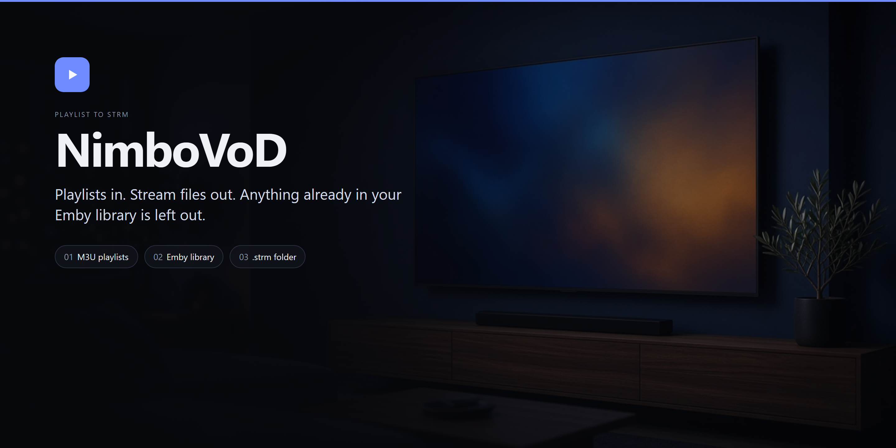
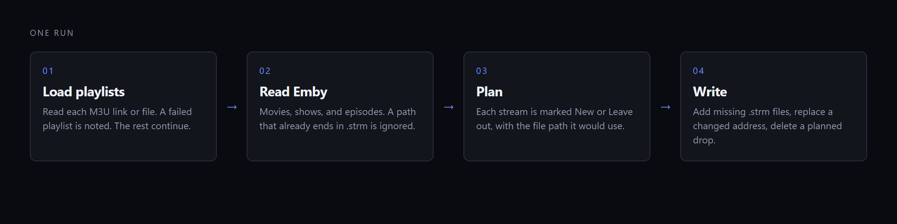
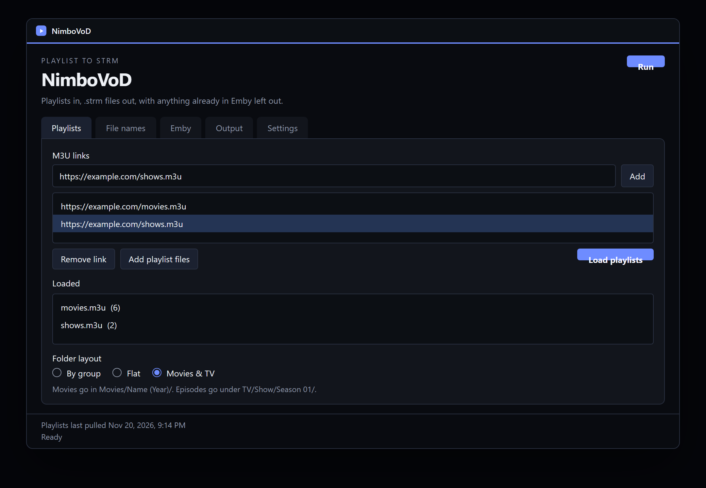
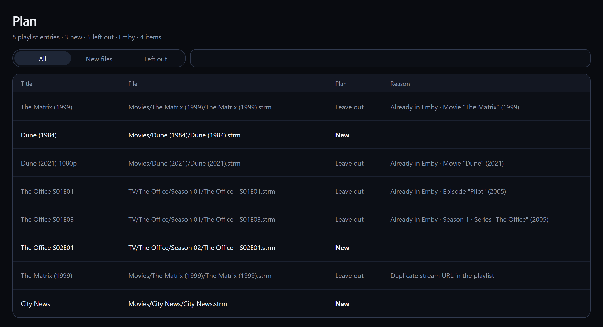
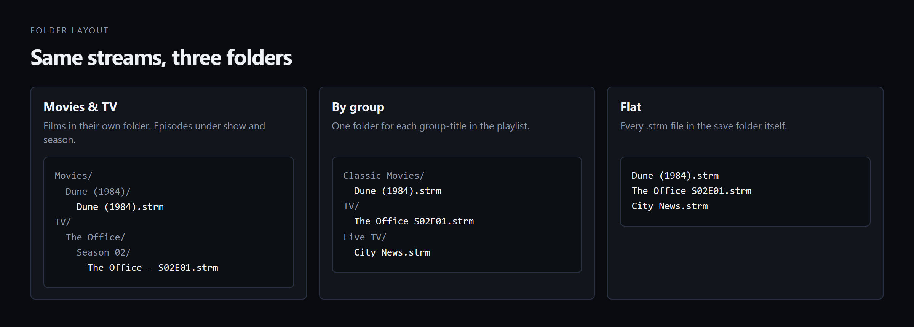
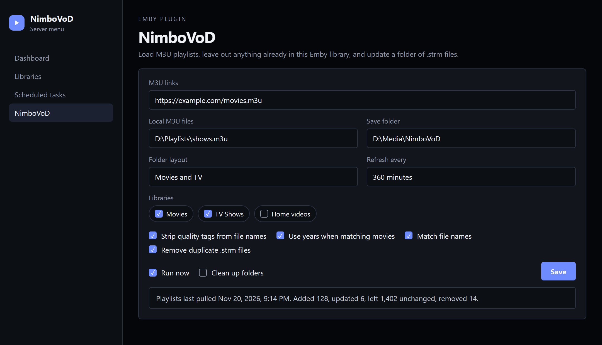

<p align="center">
  
</p>

<h1 align="center">NimboVoD</h1>

<p align="center">
  Playlists in. <code>.strm</code> files out.<br>
  Anything already in your Emby library is left out.
</p>

<p align="center">
  
</p>

NimboVoD reads M3U playlists, compares every stream with your Emby library, and keeps a folder of `.strm` files for what you do not already own. A `.strm` file is one line: the stream address. Point an Emby library at that folder and the new streams show up beside the rest of your media.

The same rules run in two places. The desktop app is for the machine in front of you. The Emby plugin runs on the server and reads the library directly.

<p align="center">
  
</p>

1. **Load playlists.** Each link is downloaded and each local file is read. One playlist can fail. The others still load. A playlist over 80 MB is refused.
2. **Read Emby.** Movies, shows, and episodes are collected from the libraries you choose. A file that already ends in `.strm` is skipped, so NimboVoD does not treat its own copies as something you own.
3. **Plan.** Every stream becomes a row: a file path, and either **New** or **Leave out**, with the reason.
4. **Write.** Missing `.strm` files are added. A file whose address changed is replaced. A file that already matches is left untouched. A planned drop that is sitting in the folder is deleted.

## The window

The desktop app is a dark window with five tabs: Playlists, File names, Emby, Output, and Settings. **Run** does the whole pass: playlists, then the Emby library, then the folder.

<p align="center">
  
</p>

| Tab | What you do there |
| --- | --- |
| Playlists | Add M3U links or local files, load them, and choose a folder layout. |
| File names | Strip quality tags, add your own tags, and drop duplicate `.strm` names. |
| Emby | Server address, API key, the libraries to compare, or a pasted list of titles. |
| Output | Save folder, write the files, open the plan, or save a text report. |
| Settings | Start with Windows, repeat on a timer, and clean the folder. |

**Write .strm files** asks before it changes the folder. A timer that includes the folder update does the same write without asking again. The first automatic pass waits one minute after the app opens, so the network and the save folder have time to show up. After that, the interval you set repeats the checked steps. Blank means once. The shortest repeat is one minute. The longest is seven days.

Settings live in `%LOCALAPPDATA%\NimboVoD\settings.json`.

## The plan

Open **View plan** before a write. This is a small library and eight streams, with Movies & TV layout, quality tags stripped, and years used for movies.

<p align="center">
  
</p>

*Dune (1984)* stays because the library has *Dune (2021)*. *Dune (2021) 1080p* is left out, and the `1080p` never reaches the file name. *The Office* season 1 is left out because a real episode of that season is already in Emby. Season 2 is new. The second copy of *The Matrix* is the same stream address, so it is kept once. *City News* has no episode pattern, so Movies & TV places it under `Movies/`.

## Folder layouts

<p align="center">
  
</p>

Quality tags such as `1080p`, `WEBRip`, `x265`, `5.1`, and release suffixes such as `-LAMA` come off the file name when stripping is on. Add more tags under **Also strip these tags**, one per line or separated by commas. Two different addresses that clean up to the same file are kept once. Turn that off and the second file is named `Title (2).strm`. A numbered leftover already in the folder, next to the plain name, is removed with the duplicates.

## What gets left out

Titles are compared after cleanup: lower case, punctuation removed, `&` read as "and", a leading "the", "a", or "an" dropped, and the last year in the name kept.

| Stream | Left out when |
| --- | --- |
| Movie | The cleaned title matches a movie or a show. If both sides have a year, the years must match. |
| Episode (`Show S01E03` or `Show 1x03`) | That episode is in Emby as a real video file, or any real episode of that season already exists. |
| Same address twice | The second copy. One stream is enough. |
| Same file name twice | The second copy, when duplicate `.strm` names are being removed. |

A show is tried three ways: the full name, the part before a colon or a pipe, then the name with a trailing "Season N" removed. File-name matching is a last resort for movies: the library file's name, without its extension, is compared the same way. Year matching and file-name matching stay on in the desktop app unless `useYears` or `matchFilenames` is set to false in `settings.json`. The plugin has switches for both.

## Writing and cleaning up

A write only touches paths that are in the plan.

| Count | Meaning |
| --- | --- |
| Added | The `.strm` file was missing. |
| Updated | The file was there, and the address changed. |
| Unchanged | The file already contained that address. |
| Removed | A planned drop was deleted, and empty folders above it were removed. |

Files that are not part of the plan stay where they are. The save folder itself stays.

**Clean up folders** is a second pass over every `.strm` file in the save folder. A file whose address matches a kept stream is moved into that stream's folder. Every other `.strm` file is deleted. Pictures, notes, and other files stay. Empty folders are removed afterward. The desktop app asks before this pass. On the plugin, turn on **Clean up folders** and press Save.

## Emby plugin

The plugin adds a NimboVoD page to the server menu. It uses the server's own library, so it does not need an API key. On startup it registers a scheduled task named NimboVoD. **Refresh every** is in minutes. `0` means the task runs only when you ask.

<p align="center">
  
</p>

Turn on **Run now**, press Save, and the update starts. The checkbox clears, and **Last result** fills in as the run moves from playlists, to the library, to the folder. The line at the end is the counts: added, updated, unchanged, removed.

Plugin 1.1.8. Built for Emby 4.8.11.

## Command line

`nimbovod-cleaner.exe` is the same planner without the window. With no flags it looks for `nimbovod.config.json` beside the program, in the current folder, or in `NIMBOVOD_HOME`. A run with no `--apply` prints the plan and writes nothing.

```text
nimbovod-cleaner.exe
nimbovod-cleaner.exe --apply

python nimbovod-cleaner.py --m3u https://example.com/movies.m3u --m3u https://example.com/shows.m3u --out "D:\Media\NimboVoD" --layout library --apply

python nimbovod-cleaner.py --emby http://192.168.1.20:8096 --api-key KEY --export library.json
```

| Flag | Effect |
| --- | --- |
| `--config` | JSON file with `m3u`, `out`, `emby`, `apiKey`, `userId`, `layout`, `stripQuality`, `useYears`, `matchFilenames`, `extraTags`, `dropDuplicateStrm`. |
| `--m3u` | Playlist URL or local path. Repeat it for each playlist. |
| `--out` | Folder for the `.strm` files. |
| `--layout` | `library`, `group`, or `flat`. The default from a bare config is `group`. |
| `--apply` | Write new files, replace changed addresses, and remove planned drops. |
| `--ignore-years` | Match movie titles when the years differ. |
| `--keep-quality` | Leave quality tags in the file names. |
| `--keep-duplicate-strm` | Keep a second file when two streams clean up to the same name. |
| `--strip-tag` | Extra tag to remove. Repeat the flag for each tag. |
| `--export` | Save the Emby library as JSON and stop. |

A home-network address such as `192.168.1.20` is fine. This program runs on your machine. The desktop library read stops at 500,000 items.

The desktop app and the plugin share one set of matching rules. `plugin/NimboVoD.Core.Tests` locks the C# planner to the same cases the Python cleaner checks: titles, seasons, duplicate files, writes, and cleanup.
