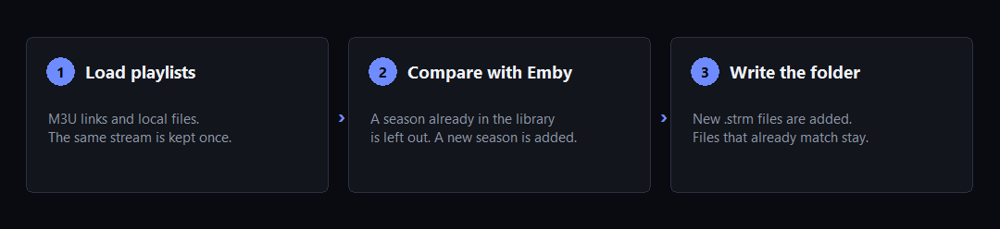
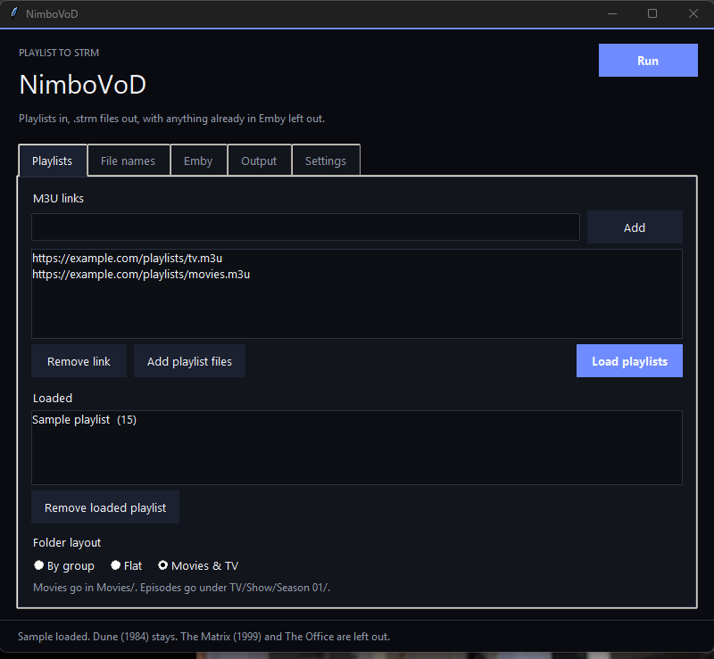
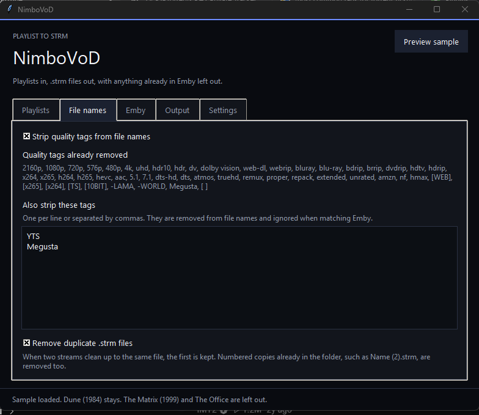
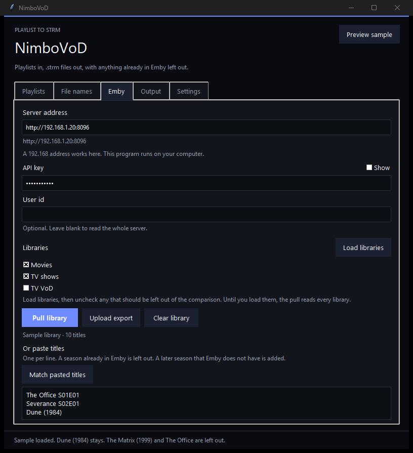
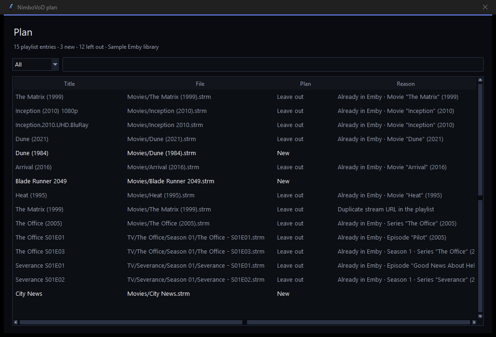
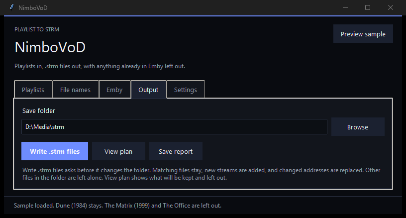
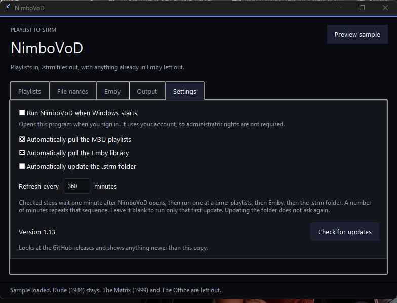

<p align="center">
  
</p>

<h1 align="center">NimboVoD</h1>

<p align="center">
  Turn M3U playlists into a folder of <code>.strm</code> files,<br>
  and leave out anything already in your Emby library.
</p>

<p align="center">
  <a href="https://github.com/Coldsac/NimboVoD/releases/latest"><strong>Download nimbovod.exe</strong></a><br>
  Windows 10 or newer · 64-bit
</p>

NimboVoD is a Windows desktop program. It runs on your computer, so a home-network address such as `http://192.168.1.20:8096` works. Windows may say it protected your PC because the file is not signed. Choose **More info**, then **Run anyway**.

<p align="center">
  
</p>

The pictures below use example playlist links, a stand-in server address, and the built-in sample playlist.

<p align="center">
  
</p>

## The window

The window opens on **Playlists**. The other tabs are **File names**, **Emby**, **Output**, and **Settings**.

**Run** is at the top of the window. It loads the saved playlists, pulls Emby, then updates the `.strm` folder, in that order. It starts immediately. A failed playlist or Emby pull skips the folder write. **Load playlists**, **Pull library**, and **Write .strm files** still do one step at a time. **Write .strm files** asks before it changes the folder.

Minimizing the window hides NimboVoD in the notification area. Click the icon to open it again. Right-click the icon and choose **Exit** to quit. The title-bar close button quits.

### Playlists

Add M3U links or choose local `.m3u` files, then click **Load playlists**. The same stream URL is kept once.

**Folder layout**

- **By group** puts each group-title in its own folder.
- **Flat** puts every file in one folder.
- **Movies & TV** uses `Movies/` for movies and `TV/Show/Season 01/` for episodes.

### File names

<p align="center">
  
</p>

**Strip quality tags from file names** is on by default. It removes tags such as `1080p`, `x265`, `[WEB]`, `[10BIT]`, `5.1`, `7.1`, `-LAMA`, and `-WORLD`. The full list is shown in the window. **Also strip these tags** removes extra words you type, both from file names and when matching Emby.

**Remove duplicate .strm files** is on by default. The first stream that cleans up to the same file is kept. Later copies are left out, and numbered files already in the folder, such as `Name (2).strm`, are removed.

### Emby

<p align="center">
  
</p>

Enter the server address and API key, then click **Pull library**. User id is optional.

Click **Load libraries** and uncheck any library that should be left out of the comparison. Until that list is loaded, every library is read. A library discovered on a later load stays unchecked until you select it.

You can also upload a library export or paste titles, one per line.

A season Emby already has as real video is left out entirely. A season Emby does not have is still added. An existing `.strm` file does not count as the library. A title such as `Show S01E02` matches that season. A subtitle after a colon, such as `Show: Other Name`, can match `Show` when that is the name Emby uses. When Emby already has the full name as its own series, that series is matched on its own.

### Plan

<p align="center">
  
</p>

**View plan** opens this list. **New** is a file that will be written. **Leave out** is a title the plan skips. Filter the list or search it. With no playlist loaded, the button asks you to load one.

### Output

<p align="center">
  
</p>

Choose the save folder.

- **Write .strm files** asks before it changes the folder. It adds new files and replaces a file whose address changed. A file whose text already matches is left as it is. A file the plan leaves out is removed only when that path is part of the plan. Other files in the folder stay.
- **Save report** writes the plan to a text file.

### Settings

<p align="center">
  
</p>

The options in that picture are an example. They start off, and **Refresh every** starts blank.

- **Run NimboVoD when Windows starts** opens the program when you sign in. It uses your account and does not need administrator rights. This is available in the downloaded program.
- **Automatically pull the M3U playlists** reloads the saved links and local playlist files.
- **Automatically pull the Emby library** reads Emby with the saved address and API key.
- **Automatically update the .strm folder** adds new `.strm` files and removes ones the plan leaves out. That step does not ask again.

**Run** does that full update immediately and does not use these checkboxes. Checked steps wait one minute after the program opens, then run one at a time: playlists, then Emby, then the `.strm` folder. A failed playlist or Emby pull skips the folder write. **Refresh every** repeats the checked steps after that many minutes, without the extra startup minute. Leave it blank to run only that first update. One minute is the shortest interval. Seven days is the longest. After the playlists load, the bottom of the window shows when they were last pulled. That time stays until the next successful pull.

**Check for updates** reads the [GitHub releases](https://github.com/Coldsac/NimboVoD/releases) and shows anything newer than this copy. **Open release page** opens that release so you can download it.

## Settings file

Settings, including the API key, are saved in plain text at `%LOCALAPPDATA%\NimboVoD\settings.json`. The program itself is not stored in git. Download it from the release above.

## Build

On 64-bit Windows, from this repository, with Python 3.12:

```
py -3.12 -m pip install pyinstaller
py -3.12 -m PyInstaller --noconfirm --clean --windowed --onefile --name nimbovod --distpath dist --add-data "src/assets/nimbovod-cleaner.py;." src/assets/nimbovod_gui.py
copy dist\nimbovod.exe nimbovod.exe
```

## Command line

`src/assets/nimbovod-cleaner.py` is the same cleaner the window uses. Without `--apply` it only prints the plan.

```
py -3.12 src/assets/nimbovod-cleaner.py --m3u https://example.com/a.m3u --out "D:\Media\strm" --emby http://192.168.1.20:8096 --api-key KEY --apply
```

`--layout` is `group`, `flat`, or `library`. `--keep-quality` leaves quality tags in file names. `--strip-tag YTS` removes an extra tag. `--keep-duplicate-strm` keeps a second file when two streams clean up to the same name.

## Emby plugin

The Windows program stays as it is. The same playlist update can also run inside the Emby server.

The plugin loads the M3U links and playlist files from its page, compares them with the library on that server, and updates the `.strm` folder. Matching follows the desktop program. A season already in Emby as real video is left out. An existing `.strm` file does not count as the library. Quality tags such as `5.1` and `7.1` are stripped before a movie is compared. A failed playlist or an empty library skips the folder write. The plugin writes nothing when it is installed. It writes when you turn on **Run now** and press **Save**, or when a refresh interval you saved comes due.

Emby draws the page from the plugin. Open the server dashboard, choose **NimboVoD** in the server menu, or open **Plugins**, right-click NimboVoD, and choose **Settings**. The page has the M3U links, **Local M3U Files**, **Browse for an M3U file**, the save folder, the layout, and the library choice. **Read every library** starts off. **Libraries** is a checkbox list of the libraries to compare. Check at least one, unless you turn **Read every library** on. Browse opens this server's folders. Press **Save** to add that file to Local M3U Files. Turn on **View tags being removed** to show the tags stripped from file names, including any extra tags saved on the page. The plugin reads the library in the server process. Playlist paths and the save folder are paths on that server. Settings from the Windows program stay in `%LOCALAPPDATA%\NimboVoD\settings.json`.

Build it with the .NET 8 SDK, from this repository:

```
dotnet build plugin/NimboVoD.Emby/NimboVoD.Emby.csproj -c Release
dotnet test plugin/NimboVoD.Core.Tests/NimboVoD.Core.Tests.csproj -c Release
```

Download [NimboVoD.Emby.dll](https://github.com/Coldsac/NimboVoD/releases/download/plugin-1.1.7/NimboVoD.Emby.dll) from the [plugin 1.1.7 release](https://github.com/Coldsac/NimboVoD/releases/tag/plugin-1.1.7). Copy only that file into the server plugins folder. On Windows that folder is usually `%AppData%\Emby-Server\programdata\plugins` or `%ProgramData%\Emby-Server\programdata\plugins`. Leave the Emby assemblies out of that folder. Replace an older NimboVoD DLL if one is already there. Restart Emby. NimboVoD is in the server menu. The Windows program stays on the [v1.14 release](https://github.com/Coldsac/NimboVoD/releases/tag/v1.14) as `nimbovod.exe`.

Turn on **Run now** and press **Save** to start one update. **Last result** changes to **Run started.**, then shows loading playlists, reading the library, and writing the folder. Reopen the page to see the latest line. A missing playlist, save folder, or library check is written there instead, and the update does not start. **Refresh every** repeats that update. `0` runs only when you use **Run now**. One minute is the shortest interval. Seven days is the longest.

The plugin version is 1.1.7. It is separate from the Windows program's version.
